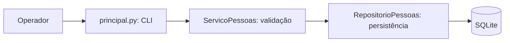

# Arquitetura

Modelo de três camadas para manter as regras independentes do armazenamento.

O banco é criado por `RepositorioPessoas.preparar()`. As consultas utilizam parâmetros, e a integridade de e-mails únicos é garantida pelo SQLite e traduzida em erro de domínio no serviço.

## Decisões
- DA-001: Python padrão e SQLite para reduzir a configuração inicial.
- DA-002: Testes com diretório temporário para evitar efeitos no banco real.
- DA-003: Não acrescentar ORM sem caso de uso demonstrado.
